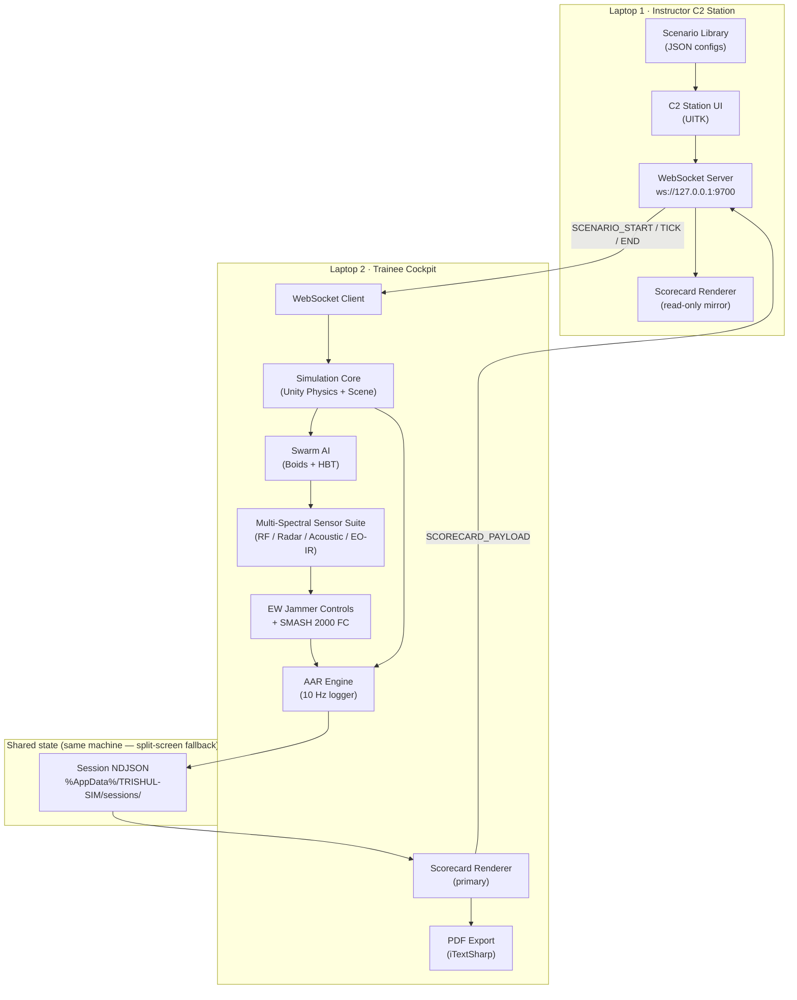

# ARCHITECTURE — TRISHUL-SIM
> Blueprint date: 2026-10-04 · Owner: Orion · Status: LOCKED for /phase-plan

---

## §1 · Stack Decision Record

Each line: decision · why · alternative rejected.

| Layer | Decision | Why | Rejected alternative |
|---|---|---|---|
| **Runtime** | Unity 2022 LTS URP (C#) | SIH26247 mandates Unity; LTS = no mid-event breakage; URP gives mobile-ready shader path for future VR | Unity 6 LTS — newer but less team familiarity; Unreal Engine — banned by MoD constraint |
| **IPC transport** | localhost WebSocket (System.Net.WebSockets, no Unity-Networking) | Air-gap requirement rules out MLAPI/Netcode; plain WebSocket is debuggable with browser devtools and log files; zero external package | UnityTransport (requires Netcode package, unnecessary complexity for 2-station) |
| **IPC server** | Instructor C2 app acts as WS server on `ws://127.0.0.1:9700`; Trainee Cockpit connects as client | Single entry-point; server is always the JCO-controlled machine; no ambiguity about who owns scenario state | Peer-to-peer / mirror topology — ambiguous authority |
| **Swarm AI** | Reynolds Boids (C# Job System, Burst-compiled) + Hierarchical Behavior Trees (NodeCanvas or custom) | Burst gives deterministic, replay-safe agent steps; HBT separates tactic logic from movement | ML-Agents — black box, non-deterministic replay, out of scope for MoD trust model |
| **Physics / sensor model** | Unity Physics + custom Friis/Doppler C# library (no external physics engine) | Keeps single-binary constraint; Friis/Doppler math is 30–50 lines, no library needed (ponytail) | Separate Python sidecar — violates air-gap .exe constraint |
| **Data store** | None at runtime; telemetry written to local `%AppData%\TRISHUL-SIM\sessions\` as newline-delimited JSON (NDJSON) | SQLite adds 1 dependency; NDJSON is grep-able, PDF-exportable by a simple C# loop | SQLite / Convex / any server |
| **PDF export** | iTextSharp (MIT) embedded in .exe | Only PDF library that compiles to Windows standalone with zero runtime install | Browser print — requires Electron / webview, adds 300 MB |
| **UI framework** | Unity UI Toolkit (UITK) + USS theming | Native to Unity; zero extra package; scales to 1920×1080 and 4K without code change; Bilingual (Hindi/English) via TextMeshPro | uGUI — deprecated path; React/web — impossible in air-gapped .exe |
| **Localisation** | Unity Localization package (CSV backend, bundled) | Official package, offline-capable, allows runtime language toggle | Custom string lookup table — same work, worse maintainability |
| **Audio** | Unity Audio with FMOD-lite (built-in DSP) | Acoustic BPF model needs real-time FFT; Unity's built-in DSP avoids FMOD Studio license | FMOD Studio — license cost; OpenAL — external DLL, risk |
| **XR scaffold** | Unity XR Plugin Management installed; one stub VR scene present; NOT on hot path | PRD SHOULD #1; scaffold proves extensibility to judges without runtime risk | Full WebXR implementation — cut (#1 on cut list) |
| **Deploy target** | Windows x86-64 .exe, IL2CPP, single installer (InnoSetup) | MoD battalion laptops are Windows; IL2CPP strips reflection for 20% smaller binary | Mono — larger binary, slower cold start on older Iris Xe |

**DECISIONS log entries for this section:** see DECISIONS.md #3 (stack), #4 (store: file over SQLite), #5 (WS server: Instructor-as-host).

---

## §2 · The Walking Skeleton

> **The ONE thread that must be green by 09 Oct 2026 (30% deadline).**

```
[Instructor C2] — user selects scenario → WS server broadcasts SCENARIO_START
        ↓ WebSocket IPC (ws://127.0.0.1:9700)
[Trainee Cockpit] — receives SCENARIO_START → Unity scene loads → Swarm spawns
        ↓ every 100 ms
[Swarm AI loop] — Boids tick → agents emit synthetic RF / acoustic / radar signatures
        ↓ every 100 ms
[Sensor Suite] — receives signatures → renders RF Waterfall + Doppler scope + Acoustic FFT
        ↓ trainee acts
[AAR Engine] — logs TelemetryRecord at 10 Hz → on SCENARIO_END writes session file
        ↓ ≤10 s
[Scorecard Renderer] — reads session file → renders Tactical Performance Scorecard → WS broadcast to both screens
```

**P0 definition (skeleton is green when ALL of these pass):**

- [ ] WS handshake confirmed (green status icon visible on both screens)
- [ ] Scenario "Punjab Border — Zero Visibility Pincer" starts on both screens within 1 s of Instructor trigger
- [ ] ≥6 Boid agents visible on Trainee Cockpit moving in formation
- [ ] RF Waterfall shows a 5.825 GHz spike during swarm approach
- [ ] 10 Hz NDJSON log file grows on disk during scenario
- [ ] Scorecard appears on both screens within 10 s of SCENARIO_END

**Oracle confirmation:** The wow-moment machinery (Zero-Visibility Pincer defeat, Scorecard render) is entirely on this thread. No beat is off-skeleton.

---

## §3 · System Sketch



**Tracks derived from this sketch:**

| Track | Owns | Does NOT touch |
|---|---|---|
| `unity-sim` | Simulation Core, WebSocket IPC (both ends), Unity scene, XR scaffold stub | Swarm AI logic, AAR scoring math |
| `swarm-ai` | Swarm AI (Boids + HBT), Sensor Suite physics models (Friis/Doppler/BPF), EW jammer deconfliction logic | UI rendering, IPC protocol |
| `aar-engine` | AAR Engine (10 Hz logger), TelemetryRecord schema, Decision Tree Scorer, Scorecard data model, PDF export | Unity scene, sensor visuals |
| `ui-ux` | C2 Station UI, Trainee Cockpit UI (UITK + USS), Scorecard Renderer UI, MIL-STD-2525 symbology layer, Bilingual localisation | Game logic, IPC, scoring math |

> **Track confirmation:** All 4 tracks from kickoff context are confirmed. No collapse warranted — each track has a clean ownership boundary with no file overlap. Contracts (§5 of workflow) are the only shared surface.
